# Patrone branding

## Logo concept 01

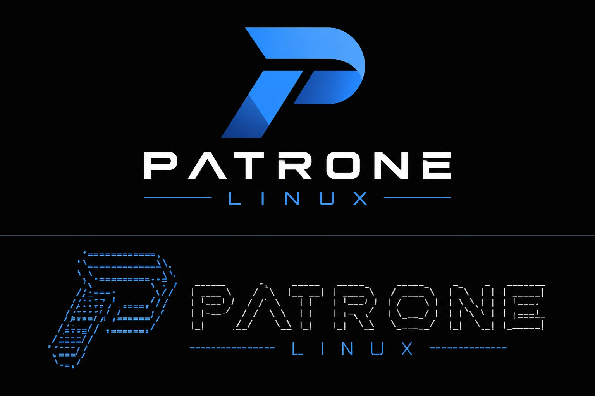

The concept has two forms.

**Primary logo (top).** A slanted geometric "P" with a blue gradient, the wide
"PATRONE" wordmark in white (the A has no crossbar), and "LINUX" in thin,
widely spaced blue capitals between two rules. Intended for:

- the login screen and lock screen
- the boot splash (Plymouth)
- the installer and its slideshow
- the About dialog, the website and the ISO's volume artwork

**Terminal logo (bottom).** The same mark drawn as dashed ASCII-style lines.
Intended for:

- the logo shown by system-info tools such as `fastfetch` (see below)
- the text-console login banner (`/etc/issue`)
- text-mode boot and recovery screens

The image here is a picture of ASCII art. The real terminal logo has to be
written as actual text characters so terminals can print it.

## Logo files

`logos/` holds transparent PNGs cut from the concept by
`tools/make_logos.py`:

| File | Size | Use |
| --- | --- | --- |
| `patrone-logo.png` | 420×420 | The mark alone (Settings → About, `LOGO=` in `os-release`) |
| `patrone-logo-text-dark.png` | 1146×248 | Mark beside the wordmark, light text, for dark backgrounds (login screen) |
| `patrone-logo-text.png` | 1146×248 | The same with dark text, for light backgrounds |
| `patrone-logo-text.svg`, `patrone-logo-text-dark.svg` | 333×72 | The two above inside SVGs 72 pixels tall, Ubuntu's logo's height on Settings → About, which shows its logo at its own size (Patrone's GNOME Settings, revision 8). Made by `tools/make_about_logos.sh`; sharp on HiDPI screens |
| `patrone-logo-stacked.png` | 840×507 | The whole primary logo, as in the concept |
| `patrone-splash.png` | 380×220 | The stacked logo at boot-splash size |

The concept is drawn on near-black, so each pixel's brightest channel becomes
its opacity and the color is recovered by undoing the blend with black. To
regenerate them:

```
python tools/make_logos.py concepts/logo-concept-01.webp logos/
```

These are stopgaps cut from a raster image; the vector masters (below)
replace them.

## In the system: the patrone-branding package

`packaging/patrone-branding` installs everything in `system/`, the logos, the
wallpaper and the fastfetch setup, replacing Ubuntu's branding:

| What you see | Patrone's version | How |
| --- | --- | --- |
| The system's name (Settings → About, `fastfetch`, the boot menu, tools that read `os-release`) | `system/os-release`: "Patrone Linux 0.1", `ID=patrone`, `ID_LIKE="ubuntu debian"` | Replaces `/usr/lib/os-release` (Ubuntu's kept as `os-release.ubuntu`) |
| Boot splash | `system/plymouth/patrone.plymouth`: the stacked logo over a spinner on black, a Patrone-blue progress bar for updates | Plymouth theme, made the default; the spinner frames are copied from Plymouth's spinner theme |
| Boot splash without graphics | `system/plymouth/patrone-text.plymouth`: "Patrone Linux 0.1" in Patrone's colors | Plymouth text theme, made the default |
| Login screen | Patrone logo; a navy-to-black background; blue accents; Patrone Sans; a blue default avatar | `system/gdm/95-patrone-settings` (logo, accent, font) and a login-screen theme: Yaru's with `system/gdm/patrone-gdm.css` added, built by `tools/make_gdm_theme.sh` and made the default `gdm-theme.gresource` |
| Text console login | `system/issue`: the name, then hostname, IP address and console | Replaces `/etc/issue` and `/etc/issue.net` |
| Welcome message at login (SSH, console) | `system/motd/00-header`: "Welcome to Patrone Linux 0.1 (...)" | Replaces Ubuntu's header; Ubuntu's help links, news and Ubuntu Pro ads are moved aside |
| Desktop | The Patrone wallpaper (its light version in the light style, the dark one in the dark style), blue accent color, Yaru's blue GTK theme and icons (GTK 3 apps don't follow the accent color), Ubuntu's dock off | `system/schemas/90_patrone.gschema.override`, new defaults that users' own settings still beat |
| Wallpapers to choose from | Wallpaper 01's family (below) in Settings → Appearance, and none of Ubuntu's | `system/backgrounds/patrone-wallpapers.xml` in `/usr/share/gnome-background-properties`. GNOME Shell depends on `ubuntu-wallpapers`, so the package provides it and replaces `ubuntu-wallpapers` and `ubuntu-wallpapers-resolute` (63 MB), which apt then removes |
| Typeface | Patrone Sans (`fonts-patrone-sans`, built in `fonts/`: Noto Sans with a tailed l and a slashed zero, every weight in one variable font), also the stand-in for Microsoft's Segoe UI, which can't be redistributed: for the desktop, apps, window titles (semibold) and the login screen; web pages and documents that ask for sans-serif, system-ui or Segoe UI get it too, in Chromium as well, with Noto Sans (from `fonts-noto-core`) behind it for scripts it doesn't cover. Patrone Settings' Theme page switches between Patrone Sans and Noto Sans, which was the typeface until 2026-10-26. Monospace stays Ubuntu Sans Mono | GNOME's font settings in the override above and `95-patrone-settings`; `system/fontconfig/05-patrone-fonts.conf` in `/etc/fonts/conf.d` and, for snaps (which don't read `conf.d`), `/etc/fonts/snap-override` |
| Settings | Ubuntu's "Ubuntu Desktop" page is named "Desktop" | `system/settings/gnome-ubuntu-panel.desktop` replaces Ubuntu's (GNOME Settings names each page from its desktop file) |

The login-screen theme is built from the Yaru that's installed when the
package is built, so rebuild the package when Yaru's GNOME Shell theme
changes. Accent colors are GNOME's named ones; `blue` is the closest to
Patrone Blue.

## Wallpaper 01

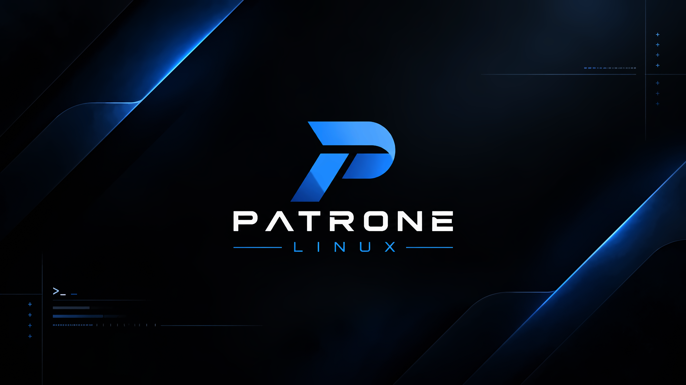

The default desktop and lock-screen wallpaper: the primary logo centered on a
near-black field with blue light streaks and faint terminal details in the
corners. It uses the same palette as the logo.

| File | Size | Use |
| --- | --- | --- |
| `wallpapers/patrone-back-01.png` | 1672×941 | Original artwork, kept as the source |
| `wallpapers/patrone-back-01-8k.png` | 7680×4320 | The 8K wallpaper the OS ships |

The 8K version is a lossless PNG on purpose. JPEG, even at quality 98, leaves
faint blotches in the dark blue gradients.

It was made from the original with `tools/upscale_wallpaper.py` (Python with
OpenCV and NumPy).
It enlarges the glows and gradients smoothly, rebuilds the logo, text and
thin lines with sharp edges at full resolution, and adds fine grain so the
dark gradients don't band. Re-run it if the original changes:

```
python tools/upscale_wallpaper.py wallpapers/patrone-back-01.png wallpapers/patrone-back-01-8k
```

An upscale can sharpen edges but can't invent detail the original never had.
If the original design file, or a higher-resolution render of it, exists, a
native 8K export from that would be better still.

### The family

Variants of wallpaper 01, all in Settings → Appearance. Those with a light
version are listed there as one wallpaper that follows the light or dark
style.

| Preview | File (`wallpapers/`) | In Settings |
| --- | --- | --- |
| 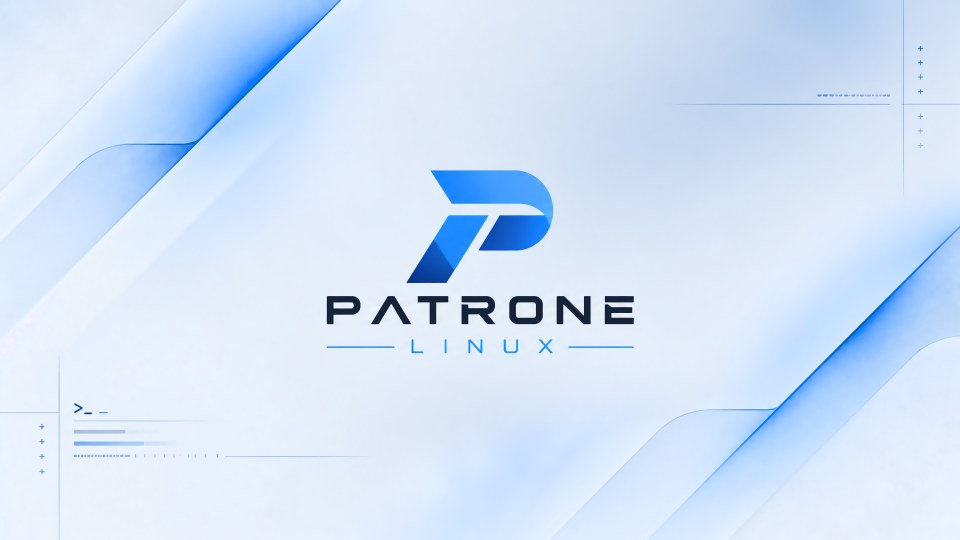 | `patrone-back-01-light.png` | Patrone, light (the default in the light style) |
| 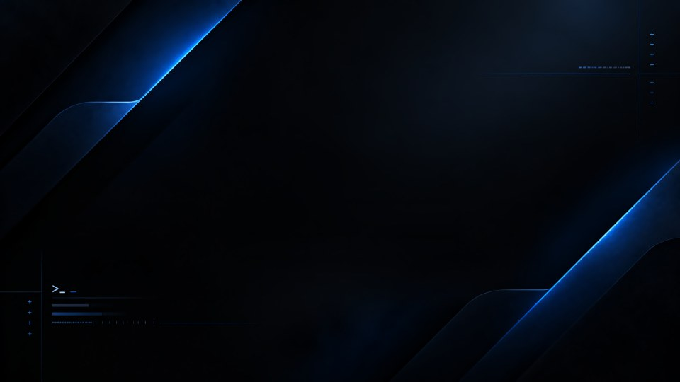 | `patrone-back-01-plain.png` | Patrone, no logo |
| 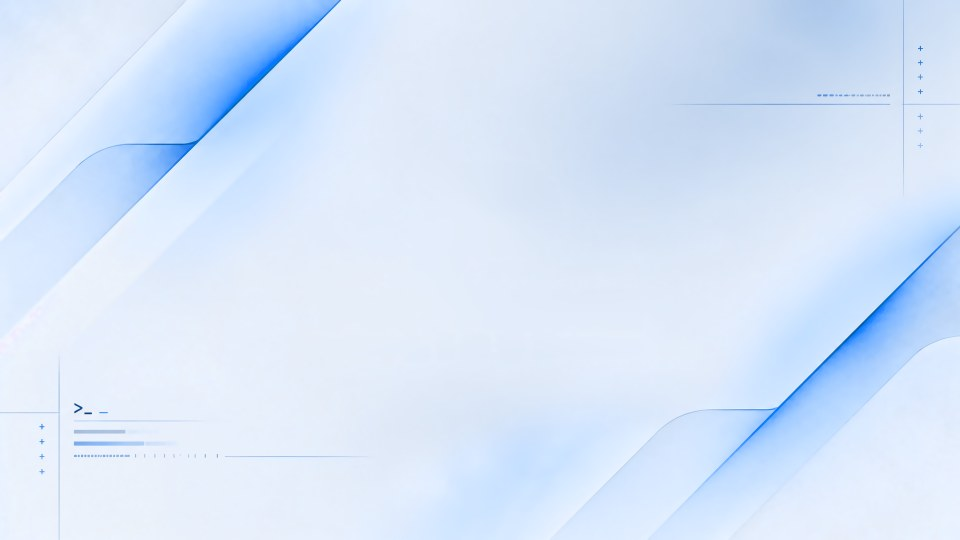 | `patrone-back-01-plain-light.png` | Patrone, no logo, light |
| 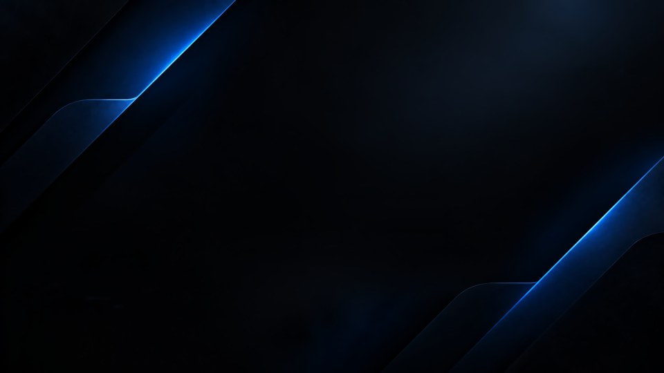 | `patrone-back-01-clean.png` | Patrone Clean: the light streaks alone |
| 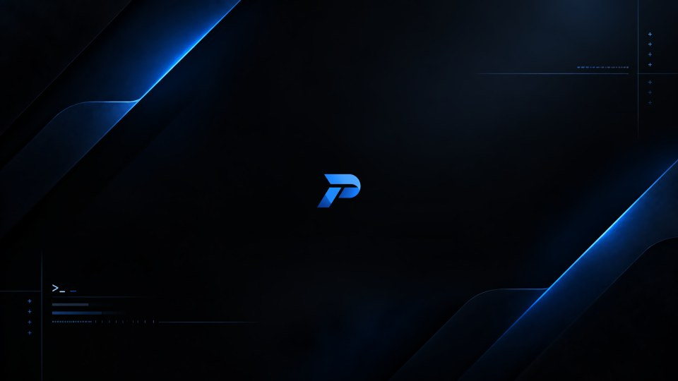 | `patrone-back-01-mark.png` | Patrone Mark: a small P in the middle |
| 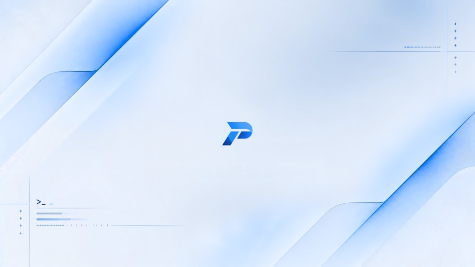 | `patrone-back-01-mark-light.png` | Patrone Mark, light |
| 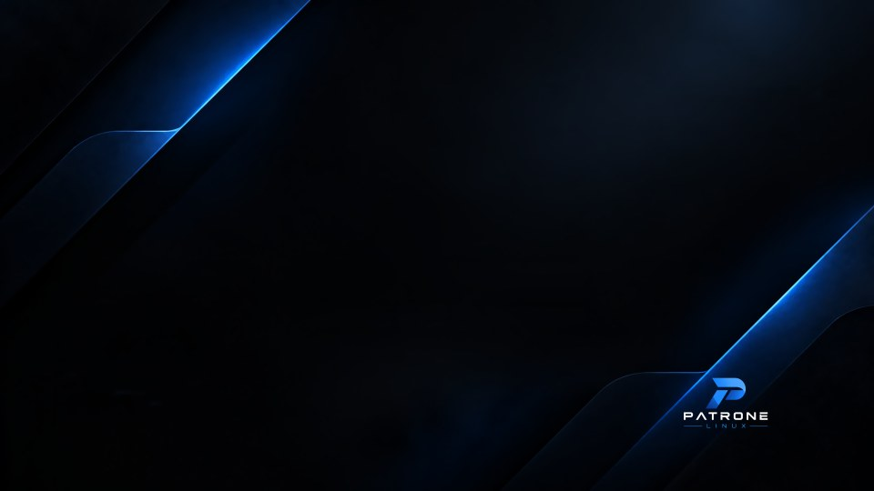 | `patrone-back-01-badge.png` | Patrone Badge: a small logo at the bottom right |
| 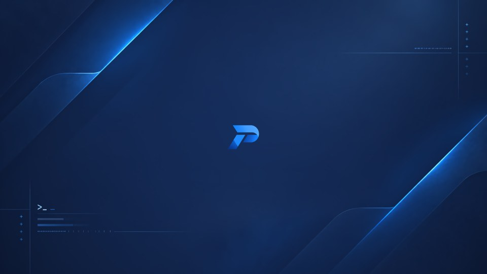 | `patrone-back-01-midnight.png` | Patrone Midnight: navy in place of black |
| 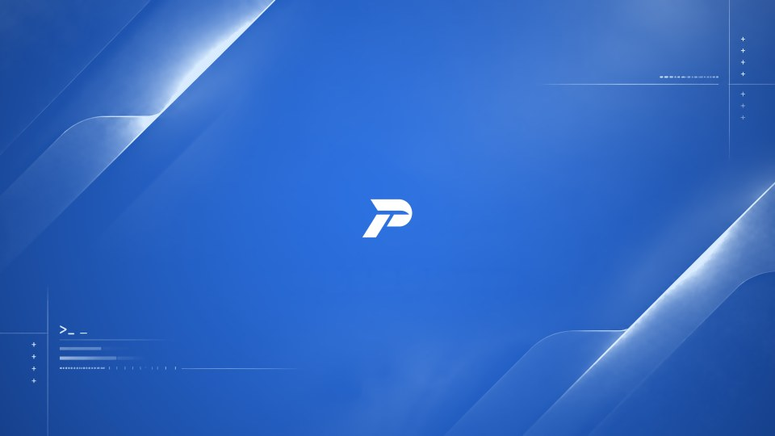 | `patrone-back-01-blue.png` | Patrone Blue: Patrone Blue, with white light and a white P |
| 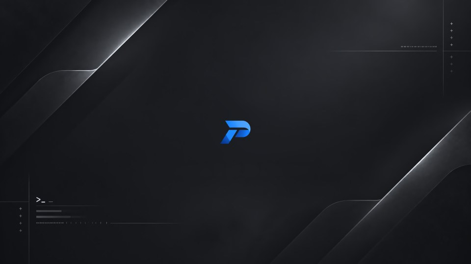 | `patrone-back-01-graphite.png` | Patrone Graphite: grey and silver, with the blue P |
| 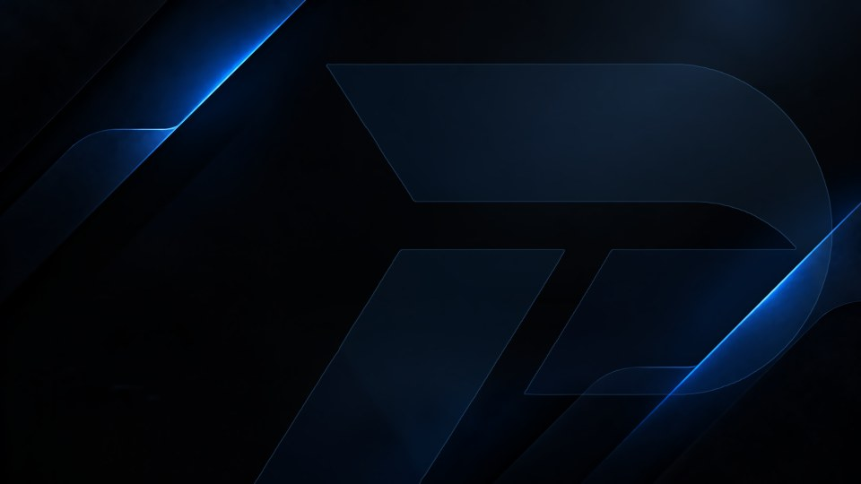 | `patrone-back-01-watermark.png` | Patrone Watermark: a giant, faint P of glass |

They're 3840×2160 PNGs of about 3 MB, made from the original by
`tools/make_wallpapers.py`. It takes the original apart with
`tools/wallpaper_layers.py` (the same steps `upscale_wallpaper.py` uses):
the background with the logo and details painted out, the corner details,
and the logo, each redrawn sharp at full size. Then a color scheme
recolors the background and details, and the logo goes back at its own
place, smaller, or not at all. The light scheme inverts lightness and keeps
the hue, so the light streaks become blue ink on a pale field, and the
wordmark turns navy.

4K holds all the detail the original has. They're dithered with an 8×8
ordered pattern instead of grain: it stops the dark gradients from banding
as well as grain does, keeps their average brightness closer to the
original's, and makes the files about a third the size. To make them again:

```
python tools/make_wallpapers.py wallpapers/patrone-back-01.png wallpapers --preview wallpapers/previews
```

Add variant names after the folder to make only those. Each is defined in
`VARIANTS` in the script: its color scheme, whether it keeps the corner
details, and its logo.

## fastfetch

`fastfetch/config.jsonc` is the system-wide fastfetch setup (installed as
`/etc/xdg/fastfetch/config.jsonc`, a path fastfetch 2.57 searches). It shows
`fastfetch/logo.txt` in Patrone Blue and Highlight, with the keys in
Highlight. The `patrone-branding` package installs it system-wide. Without
the package, install it for your user:

```
./branding/fastfetch/install-dev.sh
```

or preview it from the repo:

```
fastfetch -c branding/fastfetch/config.jsonc --logo branding/fastfetch/logo.txt
```

`logo.txt` is traced from the primary mark in `concepts/logo-concept-01.webp`
by `tools/make_terminal_logo.py`: quadrant block characters (▟ ▛ and so on)
give each character cell four "pixels", and a diagonal gradient through the
five Patrone blues runs from the top right to the bottom left. Below the
mark are the wordmark and the ruled "LINUX". To regenerate it:

```
python tools/make_terminal_logo.py concepts/logo-concept-01.webp fastfetch/logo.txt
```

`$1` to `$5` in the file are the blues (Highlight to Shadow), `$6` the
wordmark's white and `$7` the rule blue, as set in `config.jsonc`. The
dashed-outline terminal logo in the concept could replace it later, but
block characters read better at this size.

## Colors measured from the concept

| Role | Hex | Where it appears |
| --- | --- | --- |
| Patrone Blue (primary) | `#288BFA` | Main body of the P |
| Highlight | `#4DA0FC` | Top-right of the P's bowl |
| Mid | `#2372DD` | Transition across the P |
| Deep | `#1851A8` | Lower stem of the P |
| Shadow | `#134394` | Darkest end of the gradient |
| Rule line / "LINUX" | `#3E91DE` | Thin rules and subtitle |
| Background | `#030303` | Near-black backdrop |
| Wordmark | `#FFFFFF` | "PATRONE" |

These come from a raster image, so treat them as a starting point. The vector
master becomes the source of truth once it exists.

## Still needed before release

- Vector (SVG) masters of the mark and the full logo.
- A mark-only version that stays readable at 16–32 px, for the app launcher
  button, panel and favicon.
- Single-color versions: white on dark, dark on light, and a GNOME-style
  symbolic icon.
- The wordmark typeface: identify a font whose license allows redistribution,
  or draw the letters as outlines.
- Name check: the word "Linux" in a product name is a trademark of Linus
  Torvalds, administered by the Linux Foundation. Check whether a public release
  needs their sublicense.
