# PatroneOS branding

## The logo

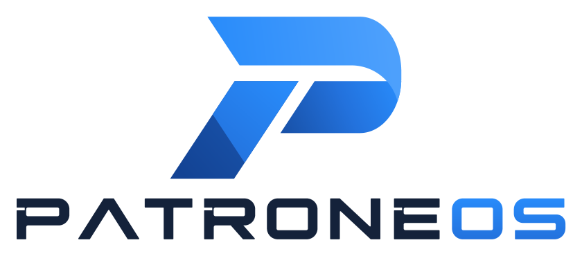

The PatroneOS logo (the user, 2026-10-29, naming the system PatroneOS:
"Use the new branding"): a slanted geometric P in
Patrone's blues over a wide PATRONEOS wordmark, PATRONE in white (navy on
light backgrounds) and OS in Patrone Blue. The P is a band across the top
that folds down round the bowl and tapers to a point, the bowl's lower half,
and a stem split by a facet into a lit part and a shaded one. Every slanted
edge leans the same way, about 57 degrees from level. The letters are wide,
squared capitals with rounded corners; the A has no crossbar, and P, R and
E have a notch under the top bar that echoes the slit in the P.

It comes from the user's two Neon Horizon pictures (wallpapers 02 and 03,
below), which show it over a scene, and replaces the first logo's
wordmark. The pictures' blues are a little more saturated, with a touch of
cyan; the logo keeps Patrone's palette (below), which the user kept for the
new branding ("Keep the colors the same").

### Drawn as vectors

`tools/patrone_logo.py` holds the logo as geometry: straight lines and
elliptical arcs, measured from the pictures at 1672×941 and tidied (one
slant for every slanted edge, one stroke weight for the letters). It writes
SVG and draws pictures of any size from the same shapes, so every logo file
matches and stays sharp. No font is involved: the letters are outlines.

`tools/make_logos.py` makes every logo file from it (about 3 seconds):

```
python tools/make_logos.py
```

| File (`logos/`) | Size | Use |
| --- | --- | --- |
| `patrone-mark.svg` | vector | The P |
| `patrone-mark-mono.svg` | vector | The P in one color (`currentColor`: black unless the page sets another) |
| `patrone-wordmark.svg`, `patrone-wordmark-dark.svg` | vector | PATRONEOS, navy and blue for light backgrounds, white and blue for dark ones |
| `patrone-logo-text.svg`, `patrone-logo-text-dark.svg` | 524×72 | The P beside the wordmark, for light and dark backgrounds: Settings → About, which shows its logo at its own size (Ubuntu's is 72 tall), and the installer (`tools/make_installer_images.sh`, 66 tall) |
| `patrone-logo-stacked.svg`, `patrone-logo-stacked-dark.svg` | vector | The P over the wordmark, as in the pictures |
| `patrone-logo.png` | 420×420 | The P (`LOGO=` in `os-release`, Settings → About) |
| `patrone-logo-text.png`, `patrone-logo-text-dark.png` | 1504×248 | The side-by-side logo; the dark one is the installer slides' |
| `patrone-logo-stacked.png`, `patrone-logo-stacked-dark.png` | 840×370 | The stacked logo |
| `patrone-splash.png` | 380×154 | The stacked logo on the boot splash |
| `patrone-logo-login.png` | 306×42 | The side-by-side logo on the login screen, which GNOME shows at the file's own size |

It also makes `icons/`: the P as Yaru's `start-here` icon at each of Yaru's
sizes, and the one-color `start-here-symbolic` and
`distributor-logo-symbolic`, 16 by 16, which GTK paints in the text's color.
The `-dark` files are for dark backgrounds, as GNOME names them. The SVG
masters are installed in `/usr/share/patrone/logos`.

### Where the logo and the wallpapers come from

The logo's design, and the wallpapers' pictures, were made with an AI image
generator. Both Neon Horizon pictures (`wallpapers/patrone-back-02.png` and
`patrone-back-03.png`, kept byte for byte as the user supplied them) carry
C2PA manifests, signed by OpenAI: generated with ChatGPT (`gpt-image`) on
2026-10-29 at 12:45 and 12:44 UTC. The first design was made the same way:
wallpaper 01's original (`wallpapers/patrone-back-01.png`) carries a
manifest from 2026-10-25, and the logo concept it shows
(`concepts/logo-concept-01.webp`) has no metadata left (WebP drops it) but
was made the same day. Both show the old name, so they left the tree on
2026-10-29 (the user: "remove anything that says" it); they're in its git
history, manifest and all.

What Patrone did on top: the vector logo, measured from the pictures and
drawn again as shapes in code; every logo file drawn from it; and the
wallpapers enlarged to 8K with the logo painted out and drawn again, their
light and dark versions and color schemes. The generated wallpapers are
different (below): code draws every pixel.

Material an AI generates without enough human authorship may not be
protected by copyright (the US Copyright Office's report on AI, Part 2,
January 2025), so `patrone-branding`'s copyright file says so, and offers
these files under GPL-3+ only as far as anyone holds copyright in them.
The name and logo are also Patrone's trademarks (`legal/eula.md`, section
3). Whether redrawing the logo in code gives enough authorship is a
lawyer's question, with a trademark search for PATRONEOS
(`docs/COMPLIANCE.md`, item 9).

## In the system: the patrone-branding package

`packaging/patrone-branding` installs everything in `system/`, the logos, the
wallpaper and the fastfetch setup, replacing Ubuntu's branding:

| What you see | Patrone's version | How |
| --- | --- | --- |
| The system's name (Settings → About, `fastfetch`, the boot menu, tools that read `os-release`) | `system/os-release`: "PatroneOS 0.1", `ID=patrone`, `ID_LIKE="ubuntu debian"`, `HOME_URL="https://patroneos.com"`, the code and issues at `github.com/billsecond/patroneos`; `system/lsb-release` says "PatroneOS" too | Replaces `/usr/lib/os-release` (Ubuntu's kept as `os-release.ubuntu`) |
| Boot splash | `system/plymouth/patrone.plymouth`: the stacked logo over Patrone's spinner (below) on black, a Patrone-blue progress bar for updates | Plymouth theme, made the default; the password prompt's images are copied from Plymouth's spinner theme, its field recolored blue (`system/plymouth/prompt/`) |
| Boot splash without graphics | `system/plymouth/patrone-text.plymouth`: "PatroneOS 0.1" in Patrone's colors | Plymouth text theme, made the default |
| Login screen | The PatroneOS logo; a navy-to-black background; blue accents; Patrone Sans; a blue default avatar | `system/gdm/95-patrone-settings` (logo, accent, font) and a login-screen theme: Yaru's with `system/gdm/patrone-gdm.css` added, built by `tools/make_gdm_theme.sh` and made the default `gdm-theme.gresource` |
| Text console login | `system/issue`: the name, then hostname, IP address and console | Replaces `/etc/issue` and `/etc/issue.net` |
| Welcome message at login (SSH, console) | `system/motd/00-header`: "Welcome to PatroneOS 0.1 (...)" | Replaces Ubuntu's header; Ubuntu's help links, news and Ubuntu Pro ads are moved aside |
| Desktop | The Neon Horizon wallpaper (its light version in the light style, the dark one in the dark style), blue accent color, Yaru's blue GTK theme and icons (GTK 3 apps don't follow the accent color), Ubuntu's dock off | `system/schemas/90_patrone.gschema.override`, new defaults that users' own settings still beat |
| Wallpapers to choose from | Neon Horizon's family, wallpaper 03 and the generated wallpapers (below) in Settings → Appearance, and none of Ubuntu's | `system/backgrounds/patrone-wallpapers.xml` in `/usr/share/gnome-background-properties`. GNOME Shell depends on `ubuntu-wallpapers`, so the package provides it and replaces `ubuntu-wallpapers` and `ubuntu-wallpapers-resolute` (63 MB), which apt then removes |
| Typeface | Patrone Sans (`fonts-patrone-sans`, drawn and built in `fonts/`: PatroneOS's own humanist sans, six weights in one variable font, Latin only), also the stand-in for Microsoft's Segoe UI, which can't be redistributed: for the desktop, apps, window titles (semibold) and the login screen; web pages and documents that ask for sans-serif, system-ui or Segoe UI get it too, in Chromium and in Flatpak apps as well, with Noto Sans (from `fonts-noto-core`) behind it for scripts it doesn't cover. Patrone Settings' Theme page switches between Patrone Sans and Noto Sans, which was the typeface until 2026-10-26. Monospace stays Ubuntu Sans Mono | GNOME's font settings in the override above and `95-patrone-settings`; `system/fontconfig/05-patrone-fonts.conf` in `/etc/fonts/conf.d` and, for snaps (which don't read `conf.d`), `/etc/fonts/snap-override`; for Flatpak apps, which see neither, a copy in `/usr/share/fonts/patrone-fontconfig` with `system/fontconfig/flatpak-fonts.conf`, which their fontconfig finds through `FONTCONFIG_PATH` (`system/environment.d/60-patrone-fontconfig.conf`) |
| Settings | Ubuntu's "Ubuntu Desktop" page is named "Desktop" | `system/settings/gnome-ubuntu-panel.desktop` replaces Ubuntu's (GNOME Settings names each page from its desktop file) |
| Help | GNOME Help, with GNOME's own front page and pages about the guide and getting help, in GNOME's 45 languages, in place of Ubuntu's "Ubuntu Desktop Guide" with Ubuntu's logo | `help/`, copied from GNOME's release of `gnome-user-docs` 50.0 by `tools/make_help.sh`: the pages Ubuntu's `gnome-user-docs` leaves out for `ubuntu-docs`, which the package replaces (Provides, Conflicts, Replaces), as it does `ubuntu-wallpapers` |
| The logo icons apps ask for (`start-here`, `distributor-logo`, and their symbolic versions) | Patrone's P, in every color of Yaru's icons and its dark style, in place of Ubuntu's logo | `icons/`, made by `tools/make_logos.py` (the P at each of Yaru's sizes, and a one-color P from its vector shapes); installed over Yaru's, which are moved aside (Yaru's `distributor-logo` icons are links to `start-here`). `os-release`'s `LOGO`, `patrone-logo`, is in the `hicolor` theme too |
| Cursors | Patrone's cursor theme (below) in place of Yaru's, on the desktop, in apps and on the login screen | Drawn by `tools/make_cursors.py` when the package is built, into `/usr/share/icons/Patrone`; made the default by `cursor-theme` in the override above (for GNOME's session, Ubuntu's and the login screen) and in `95-patrone-settings`, and made the system's default cursor theme (`x-cursor-theme`, priority 200 over Adwaita's 90) for programs that don't read GNOME's settings |

The login-screen theme is built from the Yaru that's installed when the
package is built, so rebuild the package when Yaru's GNOME Shell theme
changes. Accent colors are GNOME's named ones; `blue` is the closest to
Patrone Blue.

## Boot spinner


A single ring (the user, 2026-10-27; it was three interlinked rings before).
A comet of light runs clockwise round it, its head sprinting and its tail
catching up, once a loop. The track is Shadow; the comet runs from a
whitened Highlight at the head through Patrone Blue to Mid.

`system/plymouth/spinner/` holds the frames for Plymouth's two-step module,
96×96 with transparency:

- `throbber-0001.png` to `throbber-0060.png`, the spinner. Plymouth plays it
  as a 2-second loop whatever the frame count, sampled 30 times a second, so
  60 frames give each tick a new one.
- `animation-0001.png` to `animation-0030.png`, the end animation: it carries
  on from the loop and lights the ring in full. The theme turns it off, but
  two-step needs the files: without them it takes the throbber's frames for
  its end animation and shows no spinner.

`tools/make_spinner.py` (Python with NumPy and Pillow) draws them, and with
`--preview` a contact sheet, the GIF above and a mock-up of the whole splash
(`system/plymouth/previews/`). The settings are at the top of the script. To
make them again:

```
python tools/make_spinner.py system/plymouth/spinner --preview system/plymouth/previews
```

## Cursors

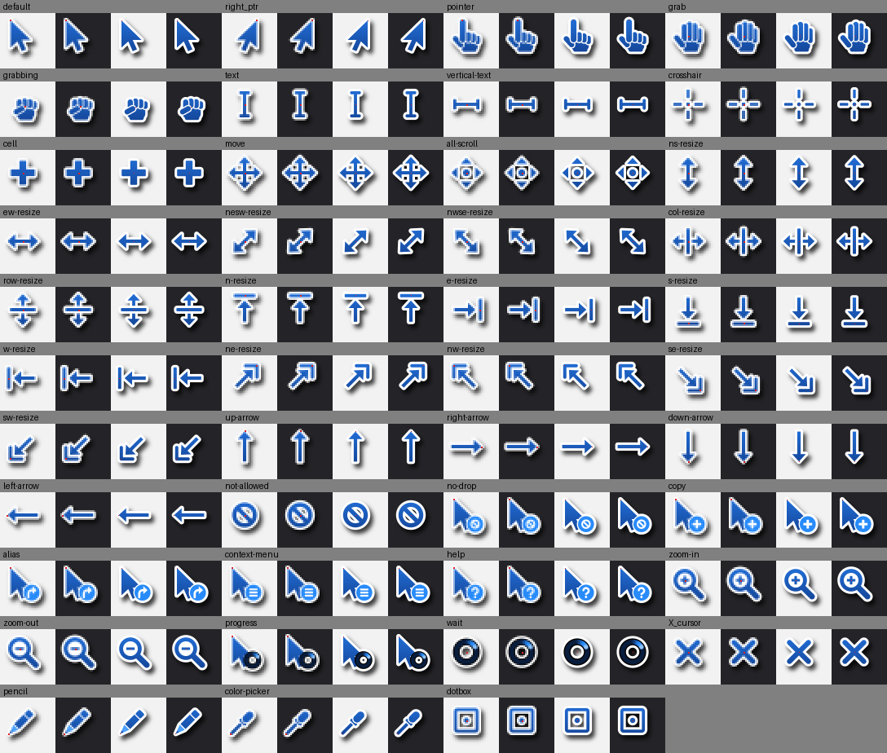


Patrone's cursor theme, `Patrone`, in place of Ubuntu's Yaru (the user,
2026-10-28, of the busy cursor). Each cursor is shaded from Mid at the top
to Shadow at the bottom, with a white edge, so it shows on light and dark,
and a soft shadow. Where parts overlap, the fingers of a hand, a thin white
seam divides them. The badges on the arrow (copy, link, help, menu, no drop)
are Patrone Blue.

The busy cursors are the boot spinner on a ring of Patrone's near-black:
"wait" alone, "progress" beside the arrow. The comet has the boot spinner's
colors and motion, a loop of 1.5 seconds (60 frames of 25 ms; at boot it's
2 seconds).

`tools/make_cursors.py` draws all 43 shapes from geometry, at 24 pixels
(GNOME's size) and 30, 32, 36, 48, 64, 72 and 96 for HiDPI screens and
fractional scales, into Xcursor files. The other 117 names programs ask for
are links: X11's (`left_ptr`, `xterm`, `watch`), Qt's, Chromium's and
Mozilla's hashed names, and every name Yaru and Adwaita have. A name the
theme lacks falls back to Adwaita's (`Inherits=Adwaita`). The package runs
it when it's built (it needs only NumPy, about 10 seconds), so the files
aren't in the repository; the previews are. To see the theme or remake the
previews:

```
python3 tools/make_cursors.py /tmp/patrone-cursors
python tools/make_cursors.py --preview system/cursors/previews
```

Flatpak apps get Patrone's cursors with no setting of Patrone's. Apps that
name a cursor shape (the cursor-shape protocol) have GNOME Shell draw it
from its theme: GTK 4 apps, and GTK 3 apps too (GTK 3.24.52 does). Apps
that load cursor images themselves find the system's themes through the
cursor library, whose built-in search path in Flatpak's runtimes ends with
`/run/host/user-share/icons:/run/host/share/icons`, where a sandbox sees the
system's icons. Setting `XCURSOR_PATH` in a Flatpak override would only
narrow that path. Checked on PatroneDev on 2026-10-28 with gedit from
Flathub (GTK 3.24.52, GNOME 51 runtime) in a hidden GNOME Shell: a GTK 3
window in its sandbox showed Patrone's text, wait, progress and pointer
cursors, asking the shell for them by shape, and libXcursor in the sandbox
loaded Patrone's files with no `XCURSOR_PATH`. Apps on older runtimes
weren't checked.

## Boot splash layout

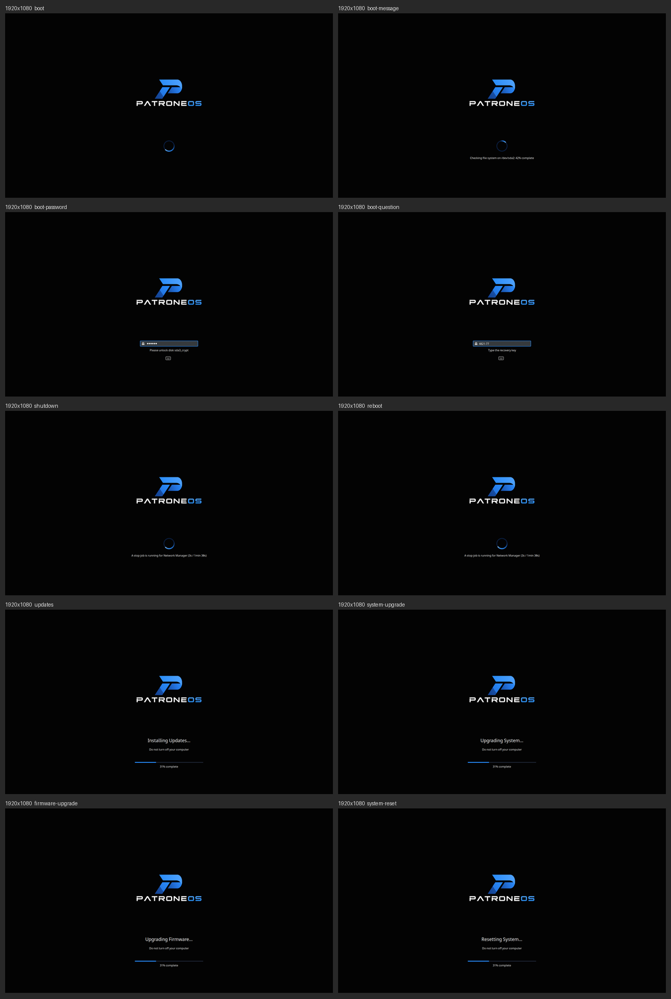

Plymouth's two-step module places each thing at a fraction of the screen's
height, so the gaps between them grow with the screen. In
`patrone.plymouth`:

| What | Where | Shown |
| --- | --- | --- |
| The logo | `WatermarkVerticalAlignment=.42` | Always |
| The spinner | `VerticalAlignment=.72`, with messages (a file-system check's, shutdown's) under it | Boot, shutdown, restart |
| The disk-unlock password or a question | `DialogVerticalAlignment=.72`, in the spinner's place, with the prompt and the keyboard layout under it | When asked; the spinner and title are hidden meanwhile |
| The title ("Installing Updates...") and subtitle ("Do not turn off your computer") | `TitleVerticalAlignment=.75`, `TitleFont=Sans 20` | The four update modes |
| The progress bar, with "31% complete" under it | `ProgressBarVerticalAlignment=.83` | The four update modes |

The title was at `.382`, Ubuntu's place for it with its logo at the bottom,
which put it on the P (the user saw it while updates installed,
2026-10-28). The update screen's text and bar now sit under the wordmark;
the gaps between them, measured in screenshots of the real `plymouthd`
(again on 2026-10-29: the PatroneOS logo is shorter than the old one, so
its wordmark ends higher):

| Screen | Wordmark to title | Subtitle to bar |
| --- | --- | --- |
| 800×600 (`previews/modes-800x600.png`, the tightest) | 54 px | 24 px |
| 1280×720 | 94 px | 34 px |
| 1024×768, 1366×768 | 110 px | 38 px |
| 1920×1080 | 213 px | 63 px |
| 2560×1440 | 331 px | 92 px |
| 3840×2160 (Plymouth draws at twice the size there, so 1920×1080's layout) | 428 px | 126 px |

The other modes never come closer to the wordmark than 20 px (a message
under the spinner at 800×600).

The password field (`system/plymouth/prompt/lock.png` and `entry.png`) is
Plymouth's spinner theme's with its orange border made Patrone Blue by
`tools/make_prompt_images.py`; its other images are copied as they are.

To see every mode without rebooting, on a Linux machine with this package
built, as root from a terminal (it draws in an invisible screen, so the
real one is untouched):

```
sudo branding/tools/preview_splash.sh out/patrone-branding_0.1.23_all.deb /tmp/splash $(tty) 1920x1080 800x600
python branding/tools/preview_splash_sheets.py /tmp/splash
```

## Wallpaper 02: Neon Horizon

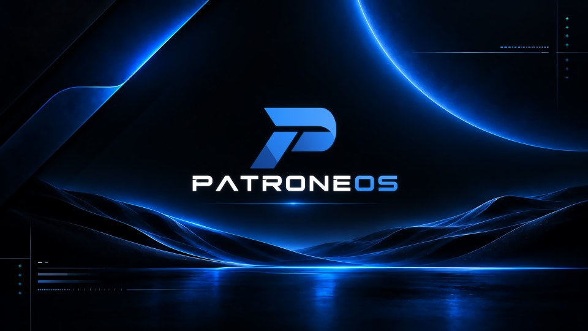

The default desktop and lock-screen wallpaper (the user, 2026-10-29: "8k
wallpapers"): the stacked logo over a dark horizon, a planet's glowing rim
above, dunes lit from behind, reflective water, a rule of light under the
wordmark and HUD details in two corners. Wallpaper 03 is the user's other
picture of the same scene, with stars and distant mountains and no HUD.

| File (`wallpapers/`) | Size | What |
| --- | --- | --- |
| `patrone-back-02.png` | 1672×941 | The user's picture, kept as the source (its C2PA manifest intact) |
| `patrone-back-03.png` | 1672×941 | The other picture, the source of wallpaper 03 |
| `patrone-back-02-dark.png` and the rest below | 7680×4320 | What the OS ships |

`tools/make_wallpapers.py` makes them (Python with OpenCV and NumPy, on
Windows, as the VM has no OpenCV). `tools/wallpaper_layers.py` takes a
picture apart at its own size: the background with the graphics painted
out, and the graphics as color and coverage. Then, at 8K:

- **The background** is enlarged with Lanczos, which suits glows and
  gradients. The logo is painted out entirely and the hole filled from the
  pixels round it (a pyramid "push-pull" fill), so no outline of it is left.
- **The logo** is drawn again from its vector shapes, sharp, exactly where
  the picture has it, with a soft glow of its own colors as the picture's
  has (not on light versions, where it would be a grey smudge).
- **The rule of light** under the wordmark is a line two pixels thick in
  the picture: its rows become the glow alone, and the line is drawn again
  sharp with the light it had, column by column.
- **The HUD details** (crosses, dashes, bars and hairlines) are enlarged
  as coverage with their edges sharpened, so they come out about 2 pixels
  wide at 8K, in their own colors.

They're lossless PNGs with an 8×8 ordered dither (`dithered8`), which stops
the dark gradients banding with no grain of its own; JPEG, even at quality
98, leaves blotches in them. They're 10 to 13 MB each, 156 MB for all 14
(wallpaper 01's family, at 4K but for its default, was 66 MB). To make them again (about 35 minutes for all
14):

```
python tools/make_wallpapers.py wallpapers --preview wallpapers/previews
```

Add variant names (`02-dark`, `03-light`...) to make only those, and
`--size W H` for another size. Each is defined in `VARIANTS` in the script:
its picture, color scheme, whether it keeps the HUD, and its logo. An
enlargement can sharpen edges but can't invent detail the picture never had:
the dunes and water are as soft as a 1672-pixel picture enlarged 4.6 times.

### The family

All in Settings → Appearance, which lists them by name. Those with a light
version are one wallpaper there that follows the light or dark style.

| Preview | File (`wallpapers/`) | In Settings | Size |
| --- | --- | --- | --- |
|  | `patrone-back-02-dark.png` | Neon Horizon (the default in the dark style and on the lock screen) | 12.1 MB |
| 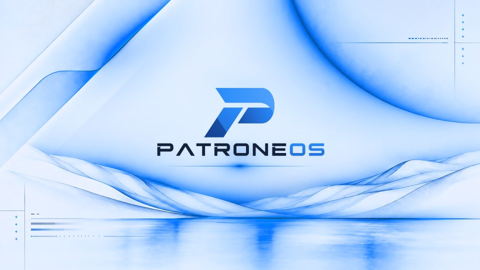 | `patrone-back-02-light.png` | Neon Horizon, light (the default in the light style): lightness inverted, hue kept, so the glows are blue ink on a pale field and the wordmark navy | 10.0 MB |
| 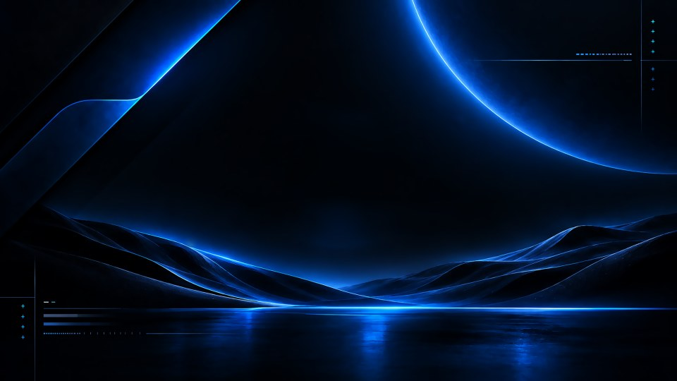 | `patrone-back-02-plain.png` | Neon Horizon, no logo | 11.7 MB |
| 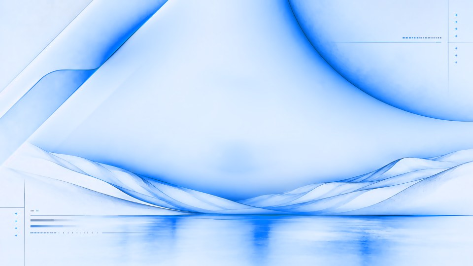 | `patrone-back-02-plain-light.png` | Neon Horizon, no logo, light | 9.7 MB |
| 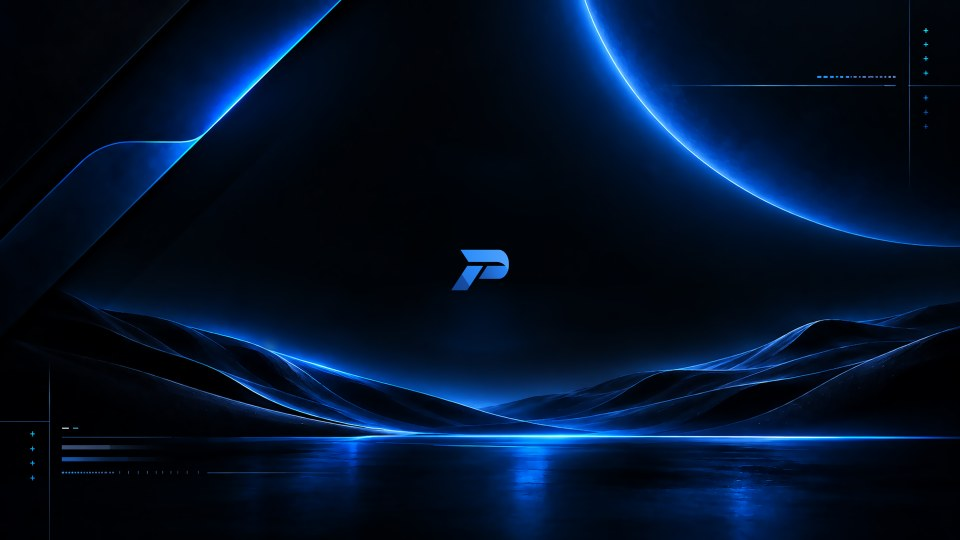 | `patrone-back-02-mark.png` | Neon Horizon Mark: a small P in the middle | 11.8 MB |
| 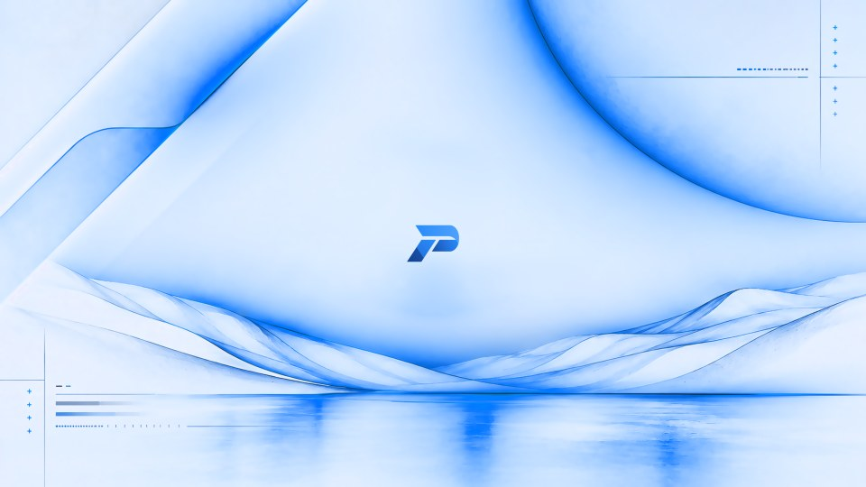 | `patrone-back-02-mark-light.png` | Neon Horizon Mark, light | 9.8 MB |
| 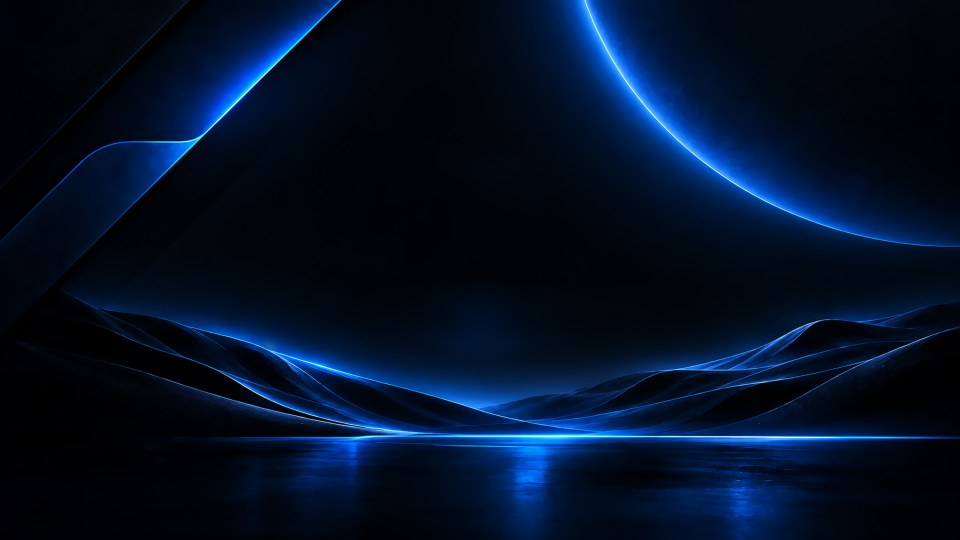 | `patrone-back-02-clean.png` | Neon Horizon Clean: the scene alone | 11.6 MB |
| 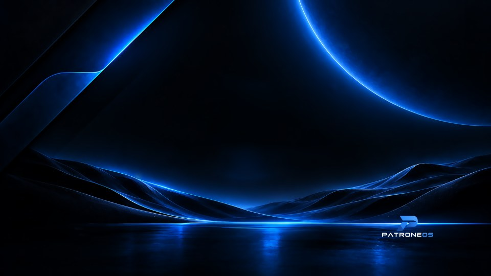 | `patrone-back-02-badge.png` | Neon Horizon Badge: a small logo at the bottom right | 11.6 MB |
| 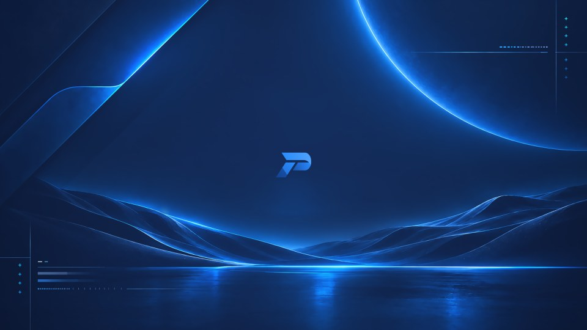 | `patrone-back-02-midnight.png` | Neon Horizon Midnight: navy in place of black | 11.3 MB |
| 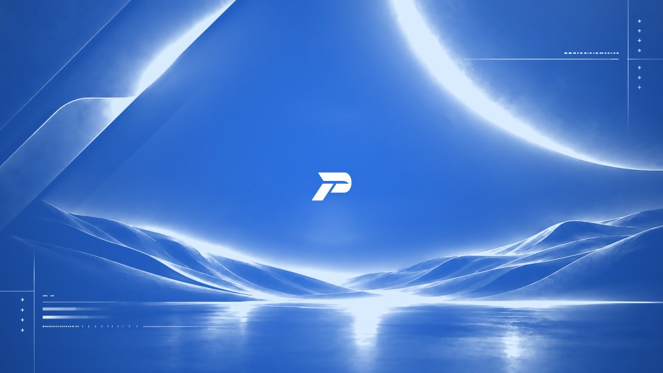 | `patrone-back-02-blue.png` | Neon Horizon Blue: Patrone Blue, with white light and a white P | 11.8 MB |
| 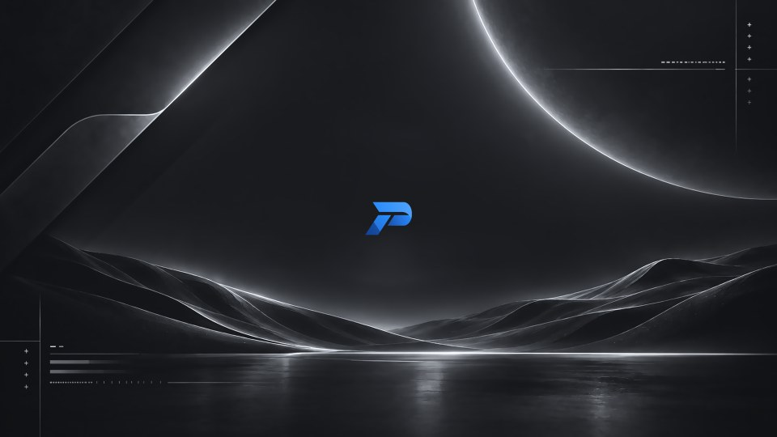 | `patrone-back-02-graphite.png` | Neon Horizon Graphite: grey and silver, with the blue P | 9.8 MB |
| 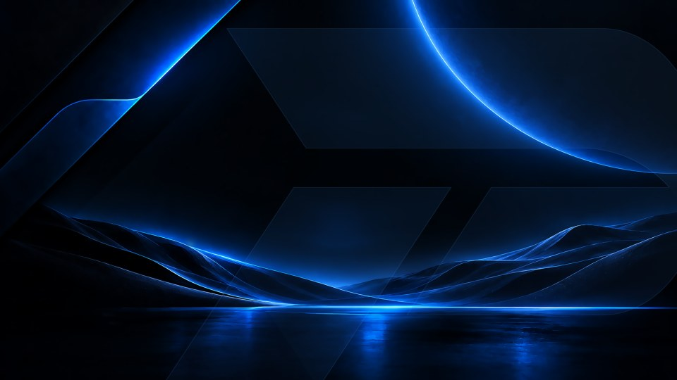 | `patrone-back-02-watermark.png` | Neon Horizon Watermark: a giant, faint P of glass | 11.8 MB |
| 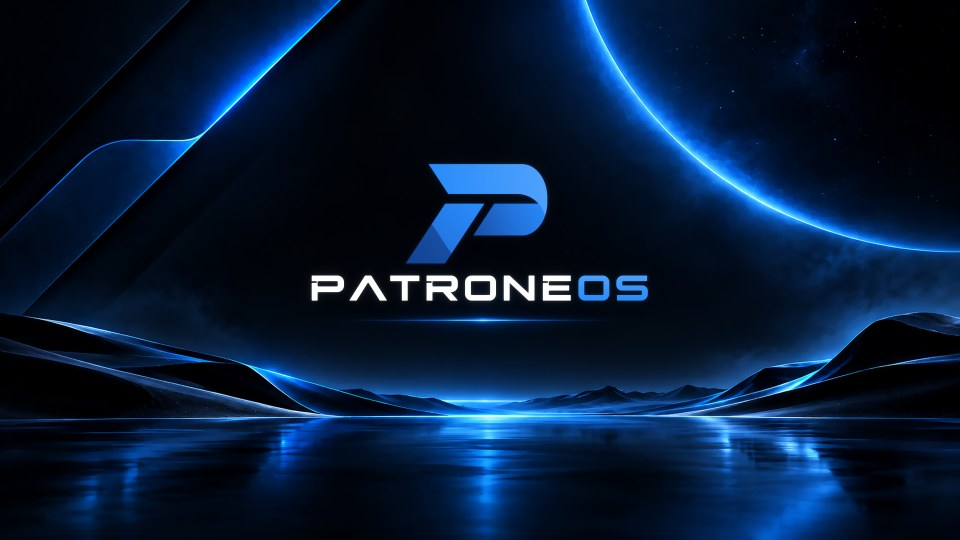 | `patrone-back-03-dark.png` | Neon Horizon Starlit (wallpaper 03) | 12.7 MB |
| 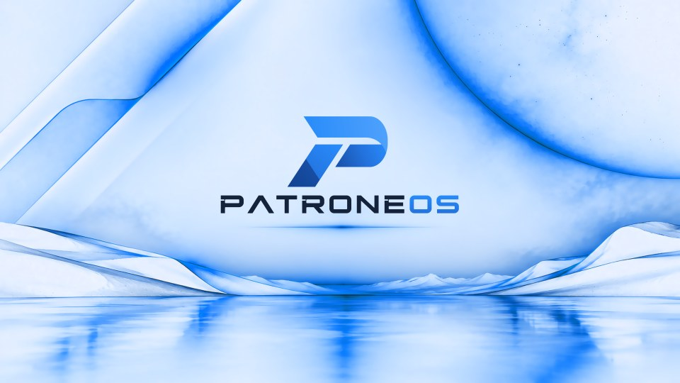 | `patrone-back-03-light.png` | Neon Horizon Starlit, light | 10.5 MB |

### Wallpaper 01, retired

Wallpaper 01 showed the old name in its logo. Its family is retired rather
than redrawn, and its original is in git history (above):
with the logo painted out it was another dark, centred scene beside Neon
Horizon's, and its 66 MB of files went towards the 8K ones. The package
still has its file names, as links to Neon Horizon's matching wallpapers
(`patrone-back-01-8k.png` to `patrone-back-02-dark.png`), so a desktop set
to one of them keeps a wallpaper. To bring it back, restore its original from git
history and give `PICTURES` in `tools/make_wallpapers.py` an entry for it
(where its logo, rules and corner details are) and variants that use it.

## Generated wallpapers

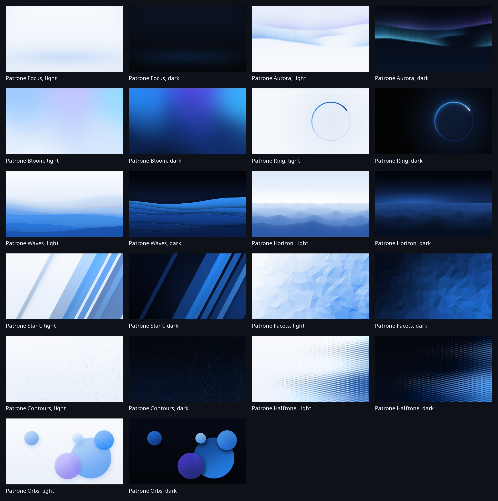

Eleven abstract designs, each a light and dark pair that follows the light or
dark style, listed in Settings → Appearance after Neon Horizon's family.
`tools/make_generated_wallpapers.py` draws every pixel from Patrone's colors
and shapes, with no photos, downloaded art or image models, so Patrone owns
them outright; they're GPL-3+ like the rest of the branding.

| In Settings | Design |
| --- | --- |
| Patrone Focus | Calm, for working: an almost flat field with a low, soft band of light |
| Patrone Aurora | Curtains of light across the sky |
| Patrone Bloom | Bold: a flowing gradient of blues with a touch of violet |
| Patrone Ring | The boot spinner's ring, large, with its comet of light |
| Patrone Waves | Bold: layered waves of blue across the lower screen |
| Patrone Horizon | Ridges fading into a lit horizon, under stars in the dark |
| Patrone Slant | Bold: panes of blue glass at the slant of the P's stem (62°) |
| Patrone Facets | Bold: low-poly facets of blue, lit from the top left |
| Patrone Contours | Calm: contour lines of an imaginary landscape |
| Patrone Halftone | Dots that swell towards one corner |
| Patrone Orbs | Overlapping discs of tinted glass |

They're `wallpapers/generated/patrone-NAME.png` (dark) and
`patrone-NAME-light.png`, 3840×2160 PNGs of 0.7 to 2.5 MB, with the same
ordered dither as the family. Lossless WebP was only 10 to 25% smaller, not
enough to be worth a format that needs its own loader. To make them again
(about 4 minutes; on Windows, as the VM has no NumPy or OpenCV):

```
python tools/make_generated_wallpapers.py wallpapers/generated --sheet wallpapers/generated/contact-sheet.jpg
```

Add design names to make only those, `--size W H` for another size, and
`--crops FILE` for a sheet of the dark ones as GNOME's "zoom" crops them on
16:10, 4:3 and 21:9 screens. Never edit the images by hand: change the
script and run it again.

- **Deterministic.** Every "random" choice is a hash of the design's seed and
  integer coordinates, not a random-number generator, whose streams can
  change between NumPy versions.
- **Any screen.** Sizes are in units of the screen's height from its middle,
  and what matters stays inside what a 16:10 screen (the middle 90% of the
  width) and a 21:9 ultrawide (the middle 74% of the height) show.
- **Adding one.** Write a function with `@design("Patrone Name")` that takes
  the canvas and `"dark"` or `"light"` and returns the picture, then add the
  pair to `system/backgrounds/patrone-wallpapers.xml`.

## fastfetch

`fastfetch/config.jsonc` is the system-wide fastfetch setup (installed as
`/etc/xdg/fastfetch/config.jsonc`, a path fastfetch 2.57 searches). It shows
`fastfetch/logo.txt` in Patrone Blue and Highlight, with the keys in
Highlight. The `patrone-branding` package installs it system-wide. Without
the package, install it for your user:

```
./branding/fastfetch/install-dev.sh
```

or preview it from the repo:

```
fastfetch -c branding/fastfetch/config.jsonc --logo branding/fastfetch/logo.txt
```

`logo.txt` is traced from `logos/patrone-logo.png` by
`tools/make_terminal_logo.py`. Each character cell takes whichever block or
shape character, in whichever color, best reproduces the logo under it over
Patrone Terminal's background:

- **Shapes:** full and partial blocks, sextants (2×3 cells), octants (2×4),
  and the diagonal wedges of Unicode's Symbols for Legacy Computing, so the
  P's slanted edges are straight diagonals rather than stair steps. VTE,
  Patrone Terminal's engine, draws all of these itself as exact shapes
  (other terminals need a font that has them; octants are the newest, from
  Unicode 16). The mark is 32 cells wide. Each line turns bold off, which
  fastfetch turns on for logos: VTE draws bold shapes thicker, and the edges
  came out streaked. They're matched as VTE draws them:
  `tools/terminal-glyphs.png` is VTE's own drawing of
  `tools/terminal-glyphs.txt`, made with `tools/render_vte.py`, which draws
  any terminal text the way Patrone Terminal does.
- **Colors:** each cell's own 24-bit color, the logo's color there, dimmed
  where the edge only partly covers the cell, so edges are shaded as a
  smoothed picture's are and the logo keeps its own light and shade. Only
  blocks and other rectangles are dimmed much (dimmed wedges' points looked
  like dark shards), and none so far that it shows as a faint square. The
  colors are taken from just inside the logo's edge, which the picture draws
  darker.

Below the mark is the wordmark, "P A T R O N E" in bold white and "O S" in
bold Patrone Blue. The colors are
written into the file as 24-bit color codes, which a `file` logo in
`config.jsonc` passes through (a `file-raw` one would ask the terminal where
the cursor is to find the logo's width, and waits when nothing answers). To
regenerate it:

```
python tools/make_terminal_logo.py logos/patrone-logo.png fastfetch/logo.txt --preview logo.png
```

`--glyphs blocks,smooth` leaves out the octants, and `--glyphs blocks` uses
only the long-standing block characters. Pictures
(sixel) would be smoother still, but Ubuntu builds VTE without them. The
first trace (2026-10-25) came from the concept picture, whose soft edges
left notches and stray blocks. It was redone from the logo on 2026-10-28
(the user: "a bit nicer/cleaner"), then with the diagonal shapes ("smooth
the edges out somehow"), then with shaded edges ("can you find a way to go
smoother?"), and on 2026-10-29 from the PatroneOS logo.

## Colors

| Role | Hex | Where it appears |
| --- | --- | --- |
| Patrone Blue (primary) | `#288BFA` | The P's band and stem, "OS" |
| Highlight | `#4DA0FC` | The top right of the P's band, the top of "OS" |
| Mid | `#2372DD` | Across the bowl and the stem |
| Deep | `#1851A8` | The bowl's left end, the stem's shaded facet |
| Shadow | `#134394` | The foot of the stem |
| Rule | `#3E91DE` | Thin rules |
| Background | `#030303` | Near-black backdrop |
| Wordmark | `#FFFFFF` | "PATRONE" on dark backgrounds |
| Navy | `#14223A` | "PATRONE" on light backgrounds |

First measured from the logo concept; the user kept them for PatroneOS. The
logo's gradients, from these colors, are in `tools/patrone_logo.py`.

## Still needed before release

- A trademark search for PATRONEOS, and a lawyer's view of the logo's
  authorship (above, and `docs/COMPLIANCE.md`, item 9).
- The P at 16 and 22 pixels is the whole mark shrunk; a simplified mark
  drawn for those sizes would read better in panels and favicons.
