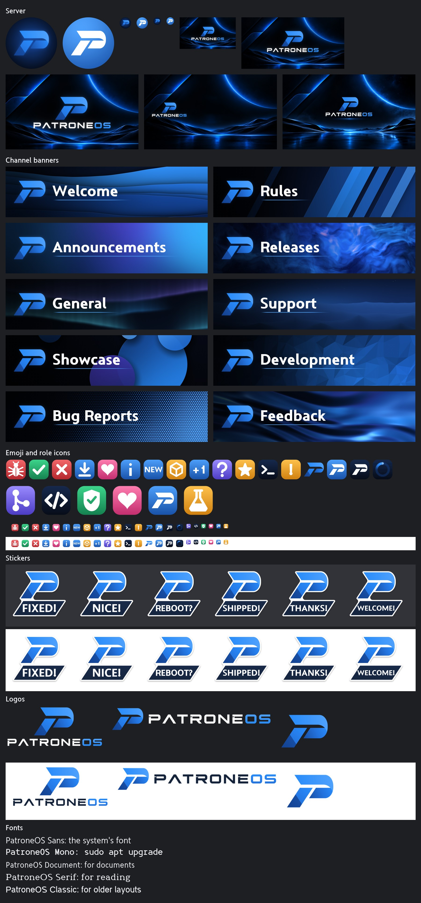

# PatroneOS on Discord

Everything for PatroneOS's Discord server, ready to upload.



## Where each file goes

Limits are Discord's own, checked on 2026-10-31. Boost levels are the ones
Discord asks for; a server without them can still use everything else here.

| Files | Size | Where it goes | Needs |
| --- | --- | --- | --- |
| `server/server-icon-blue.png` | 1024×1024 | Server Settings → Profile, the icon. White on blue, the one that reads best at sidebar size. Discord crops it to a circle | Nothing |
| `server/server-icon.png` | 1024×1024 | The same spot, a darker choice: the blue P on navy. Good for a bot's avatar too | Nothing |
| `server/server-banner.png` | 1920×1080 | Server Settings → Profile, the banner | Boost Level 2 |
| `server/invite-background.png` | 1920×1080 | Server Settings → Profile, the invite background. The logo sits left of the invite's card | Boost Level 1 |
| `server/discovery-splash.png` | 1920×1080 | Server Settings → Discovery | A Community server in Discovery |
| `server/event-cover.png` | 1600×800 | The cover of a scheduled event. Discord crops covers, so the logo stays in the middle | Nothing |
| `channel-banners/` | 1600×400 | Post one at the top of its channel, above the channel's first message | Nothing |
| `emoji/` | 128×128, under 256 KB | Server Settings → Emoji, which has 50 free slots. Discord names each emoji from its file name, so `patrone_check.png` is `:patrone_check:`. `patrone_loading.gif` is the boot spinner, animated, and only members with Nitro can use it | Nothing |
| `role-icons/` | 256×256, under 256 KB | Server Settings → Roles → a role → Display | Boost Level 2 |
| `stickers/` | 320×320, under 512 KB | Server Settings → Stickers, which has 5 free slots, so one of these six waits for Boost Level 1. Each needs a related emoji | Nothing |
| `images/` | 1920×1080 | Wallpapers to post | Nothing |
| `logos/` | Up to 2400 wide | Transparent logos for anything else. `-dark-bg` files are for dark backgrounds, with white lettering, and `-light-bg` files for light ones. `logos/svg/` has the vector masters | Nothing |

Discord can't put a new message above an old one, so post a channel's banner
before anything else goes in it. In a channel that already has messages, the
banner lands below them.

## Fonts

`fonts/` is PatroneOS's five font families as TTF files, version 1.1.0, exact
copies from [billsecond/patroneos-fonts](https://github.com/billsecond/patroneos-fonts).
They're for making more graphics: on Windows, right-click a file and choose
Install. Discord doesn't let a server choose a font, so chat text stays in
Discord's own. The SIL Open Font License, `fonts/OFL.txt`, has to stay with
the files wherever they're shared.

## Making them again

Never edit the images by hand. Change the script and run it again (about a
minute; on Windows, as the VM has no OpenCV):

```
python tools/make_discord_assets.py
```

To add a channel, add a line to `CHANNELS` in the script. It ends by checking
every file against the limits above. When fonts change, copy the new release
over `fonts/` first, as the banners and stickers are set in PatroneOS Sans.

## Where they come from

The logos and the text are drawn from code. The server images and `images/`
use the Neon Horizon pictures, and the channel banners the generated
wallpapers, so each has the terms `branding/README.md` gives for its source.
