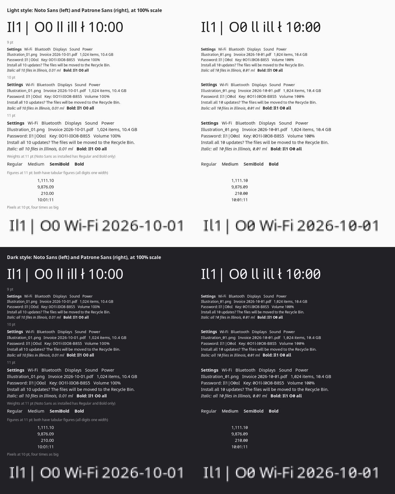

# Patrone Sans

Patrone's interface typeface: Noto Sans 2.015 with a tailed **l** and a
slashed **0**, so that I, l, 1, | and O, 0 can't be mistaken for one
another in passwords, keys, codes and file names. Everything else is Noto
Sans's: its look, spacing, kerning, line height, features and its Latin,
Greek and Cyrillic. `FONTLOG.txt` lists each change and why.



| File | What |
| --- | --- |
| `ttf/PatroneSans[wght].ttf` | Upright, a variable font with one axis, weight, 100 to 900, and named instances at every hundred |
| `ttf/PatroneSans-Italic[wght].ttf` | Italic, the same |
| `OFL.txt` | The license, SIL Open Font License 1.1, with Noto's copyright and this one |
| `FONTLOG.txt` | The changes from Noto Sans, and the reasons |
| `build.sh` | Builds `ttf/` from Noto Sans's sources |
| `requirements.txt` | The build tools' versions |
| `tools/patrone_sans.py` | The changes, made to Noto Sans's masters |
| `tools/finish.py` | The last step: gasp table, names checked |
| `tools/comparison_sheet.py` | Draws `comparison.png` |
| `tools/proof.py` | Draws text big, to look at letters |
| `fontbakery-report.md` | fontbakery's report on the fonts in `ttf/` |

The package is `fonts-patrone-sans`
(`packaging/fonts-patrone-sans`), which installs the fonts in
`/usr/share/fonts/truetype/patrone-sans/`. Patrone Settings (Theme →
Font) and GNOME Settings' Patrone page switch the desktop between Noto Sans
and Patrone Sans.

## The changes

- **l has a tail**, the foot of Noto Sans's own t, in every weight and in
  the italic. l gets wider by the tail (258 to 290 units in the regular
  weight), and so do the letters made from it (ł, ľ, ŀ, ĺ, ļ, fl, lj...).
- **0 has a slash**, Noto Sans's own (it was the `zero` feature), in the
  default (tabular) and proportional figures. Superscripts, fractions and
  oldstyle figures keep the plain zero.
- **One axis, weight**: Noto Sans's width axis is left out. Every weight is
  there, medium and semibold too (Ubuntu's Noto Sans package has only
  regular and bold, so its window titles had to be bold).
- **Names and notices**: Patrone Sans, version 1.000, vendor PTRN, Noto's
  copyright kept and its trademark notice dropped (the name isn't Noto).
- **Hinting**: none in the font, on purpose, and a gasp table asking for
  smoothing at every size. With GNOME's default hinting ("slight"),
  FreeType hints every TrueType font with its own autohinter and ignores
  the font's instructions; checked on the VM, where Ubuntu's Noto Sans
  and a copy with its instructions removed drew the same pixels at
  "slight" (and different ones at "full"). With no instructions, FreeType
  autohints Patrone Sans at "full" too.

Unchanged on purpose: the x-height, apertures and spacing (Noto Sans was
drawn for screens), the vertical metrics (ascender 1069, descender 293, no
line gap, exactly Noto Sans's, so switching fonts moves nothing on screen)
and the figures, which were already tabular by default, with proportional
ones in `pnum`.

Noto Sans's license (OFL 1.1) names no Reserved Font Name, so a modified
version may keep any name but Noto (Google's trademark). Patrone Sans
stays under the OFL; the fonts can't be sold by themselves.

## Building

On the dev VM (or any Linux with python3, git and curl):

```
fonts/build.sh
```

It makes a venv and clones Noto Sans's sources at the `NotoSans-v2.015`
tag (commit `c4a321e1`) into `~/.cache/patrone-sans` (the first run needs
the network; no sudo: Ubuntu's python3 has no pip, so pip comes from
`get-pip.py`), then, for upright and italic:

1. `glyphs2ufo` turns the Glyphs sources into UFO masters and a
   designspace (with Noto's GDEF categories and unexported glyphs, as
   `fontmake -g` would);
2. `tools/patrone_sans.py` drops the width axis and its masters, makes the
   changes in every master (and the intermediate SemiBold masters some
   glyphs have) and renames the family;
3. `fontmake` compiles the variable font;

then `gftools gen-stat` writes the STAT table for both,
`tools/finish.py` finishes them, and fontbakery's universal checks run
(`--no-check` skips them). It takes about 90 seconds. Dates in the fonts
come from the sources' commit (`SOURCE_DATE_EPOCH`), so a rebuild gives
the same bytes: two builds in a row had the same SHA-256.

`ttf/` is kept in the repository, since a package build can't fetch Noto
Sans's 117 MB of sources or the tools.

The comparison sheet needs the system's python3 (for PyGObject):

```
python3 fonts/tools/comparison_sheet.py comparison.png fonts/ttf/*.ttf
```

## What was checked

- **fontbakery 1.1.0** (`check-universal`): no errors, 5 fails, 13 warnings
  (`fontbakery-report.md`). Unmodified Noto Sans 2.015, built from the same
  sources with `fontmake -g`, has every one of them too (and more): the
  case mapping of a few letters, a zero-width base character (U+2E3C),
  `smart_dropout` (which is about Windows; Patrone Sans has no
  instructions on purpose, see above), overlapping segments in three
  Cyrillic and Latin glyphs, unreachable glyphs and long glyph names.
- The glyph set and the GDEF classes are exactly Noto Sans 2.015's (3884
  glyphs upright, 3895 italic).
- The vertical metrics are exactly Ubuntu's Noto Sans's (2.004).
- Looked at, drawn big: l, ł, ŀ, ľ, ļ, fl, lj, 0 and the proportional 0 in
  light, regular and bold, upright and italic.
- `comparison.png`: Ubuntu's Noto Sans (2.004, what Patrone has used) and
  Patrone Sans at 9, 10 and 11 pt, light and dark, through Pango and cairo
  at 96 dpi with GNOME's defaults. A line of text comes out the same width
  to within a pixel or so.

Not checked: Chromium and other apps that read fonts themselves, Windows or
macOS rendering, and every language Noto Sans covers (the changes touch
only l and its letters, and 0).
